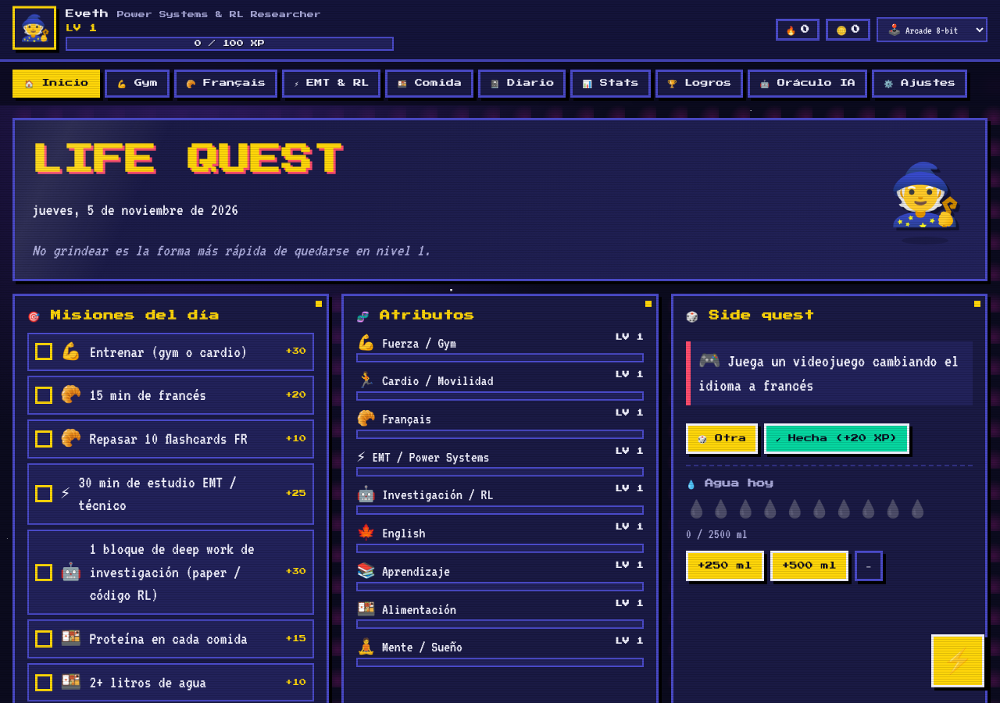
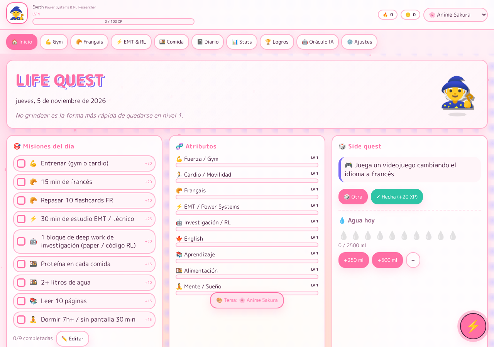

# ⚔️ LIFE QUEST

> Tu vida como un RPG retro. Gana XP entrenando, estudiando francés, dominando transitorios electromagnéticos y comiendo bien.

**Life Quest** es una web app de una sola página (HTML + CSS + JS puro) para organizar tus días y llevar el registro de tu progreso en varias áreas de tu vida, con estética **anime / videojuego vintage** y **7 temas** intercambiables.

| | |
|---|---|
|  |  |

## 🎮 Funciones

| Área | Qué puedes hacer |
|---|---|
| 📅 **Agenda** | Línea de tiempo del día con bloques y marca de "ahora", plantilla de día ideal, tareas con prioridad y fecha (dan XP), hábitos de 7 días y metas semanales por área |
| ⏳ **Focus** | Temporizador animado que **se construye mientras te concentras**: 🌲 un bosque que crece del amanecer a la noche, 🪐 un sistema planetario que se forma, o ⚛️ el experimento de la doble rendija, donde la interferencia emerge partícula a partícula. Sigue corriendo aunque recargues |
| 🏠 **Inicio** | Misiones diarias con XP, barras de atributos por área, *side quests* aleatorias, contador de agua, mapa de actividad (heatmap de 20 semanas), vista previa del Focus, agenda de "ahora y siguiente", registro reciente |
| ⚡ **Registro rápido** | Botón flotante ⚡ (o tecla **Q**): un clic y queda registrado (gym, cardio, francés, EMT, lectura, agua, meditación...) |
| 💪 **Gym** | Rutinas Push / Pull / Legs / Full body / Core, series × reps × kg, **detección de PRs**, 1RM estimado, gráfica de progreso por ejercicio, peso corporal |
| 🥐 **Français** | Flashcards A1-A2 con **repetición espaciada** (vocabulario de ingeniería, gym y comida), pronunciación con voz 🔊, *phrase du jour*, minutos de estudio, ruta A1 → B1, recursos |
| 🤖 **Investigación RL** | Ruta del paper de Maskable PPO (respuesta a revisores, camera-ready), siguientes pasos de investigación, herramientas y carrera académica |
| 🕹️ **RIFTVOLT** | Tarjeta con tus estadísticas del juego. Completar tus misiones da bonus en el juego |
| ⚡ **EMT** | *Skill tree* de transitorios electromagnéticos para **data centers** (inrush, ferroresonancia, IBR / grid-forming, IEEE 2800 / 519, PSCAD...), bitácora técnica, horas acumuladas, biblioteca |
| 🍱 **Comida** | Registro de comidas con proteína / kcal / calidad, metas diarias, gráfica de proteína de 14 días, ideas altas en proteína |
| 📓 **Diario** | Ánimo, sueño, energía, gratitud, reflexión y prioridad de mañana |
| 📊 **Stats** | Radar de atributos, minutos por área, XP diario apilado, ánimo y sueño |
| 🏆 **Logros** | 16 logros desbloqueables + **tienda de recompensas** donde gastas tus 🪙 monedas |
| 🤖 **Oráculo IA** | Arma un resumen de tus registros y lo abre en **claude.ai** con tu pregunta (también lo copia al portapapeles) |
| ⚙️ **Ajustes** | Nombre, clase, avatar, metas, sonidos 8-bit, efectos, editor de misiones, **exportar / importar JSON** |

### 🎨 Temas
🕹️ Arcade 8-bit · 🌸 Anime Sakura · 🌃 Cyberpunk Neón · 🟩 Game Boy · 📜 RPG Pergamino · 🌴 Vaporwave · 🔥 Shōnen

## 🚀 Publicar con GitHub Pages

1. En el repo: **Settings → Pages → Build and deployment → Source: _Deploy from a branch_**, rama `main`, carpeta `/ (root)` → **Save**.
2. En 1-2 minutos estará en `https://<tu-usuario>.github.io/<nombre-del-repo>/`.
3. En el celular: ábrelo y elige **"Agregar a pantalla de inicio"** para usarlo como app (funciona sin conexión).

> Para usarlo en local, basta con abrir `index.html` en el navegador.

## 💾 ¿Dónde se guardan mis datos?

En el **navegador** (`localStorage`), así que cada dispositivo tiene sus propios datos. Para respaldarlos o pasarlos a otro dispositivo usa **Ajustes → Exportar JSON** y luego **Importar JSON**.
Puedes subir esos respaldos a la carpeta [`data/`](data/) para tenerlos versionados. **Ojo:** si el repo es público, esos archivos también lo serán.

## ✏️ Personalizar

Casi todo el contenido está en [`js/data.js`](js/data.js): misiones, acciones rápidas, rutinas, ruta EMT, ruta y flashcards de francés, side quests, frases, logros y prompts para la IA. Edítalo directamente en GitHub (✏️) y los cambios se publican solos.

## 🗂️ Estructura

```
index.html        → estructura de la app
css/styles.css    → estilos + 7 temas
js/data.js        → contenido editable
js/app.js         → lógica (XP, niveles, registros, gráficas)
sw.js, manifest.json, icon.svg → modo app / offline
data/             → tus respaldos JSON
```

Hecho con ❤️, píxeles y café ☕.


## 🤖 Para desarrolladores y LLMs
Lee **[AGENTS.md](AGENTS.md)**: arquitectura, modelo de datos, API de módulos y roadmap.
